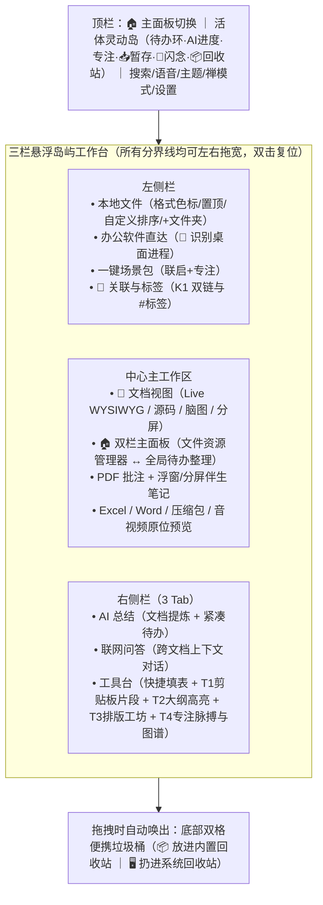

# SmartLocalNote V7 全功能使用教程

> **Local-First · 极致轻量（15 KB 原生守护进程 / 静默 0.08 MB 内存）· 全格式本地知识工作台**  
> 所有笔记与附件均为真实磁盘明文文件，保存在程序同级 `data/` 目录中，永不绑架你的数据。

---

## 一、快速上手与极致轻量运行机制

### 1. 启动与唤起
- **双击 `SmartLocalNote.exe`**：启动 15 KB 纯原生 C11 守护进程（托盘常驻，静默期仅占约 `0.08 MB` 内存、CPU `0%`）。
- **全局秒唤快捷键**：在 Windows 任意界面按 **`Alt + Space`** 秒速唤起或隐藏主窗口（自动接管输入焦点）。
- **托盘菜单**：右键系统托盘图标可一键「显示/隐藏窗口」「开机自启」「退出程序」。
- **自动内存回收**：关闭或隐藏主界面空闲后，守护进程通过 Windows Job Object **彻底销毁整个 UI 与 WebView2 进程树**（零僵尸进程），所有内存归还系统；下次唤起自动恢复上次打开的文档与窗口位置。

### 2. 核心快捷键速查表

| 快捷键 | 功能 |
| :--- | :--- |
| **`Alt + Space`** | 全局秒唤 / 隐藏 SmartLocalNote（系统级热键） |
| **`Ctrl + K`** | 唤出 Spotlight 全局搜索与命令面板（找笔记 / 找文件 / 启软件 / 语义检索） |
| **`Ctrl + N`** | 新建笔记（免必填，留空直接回车自动递增 `新建笔记1`、`新建笔记2`…） |
| **`Ctrl + S`** | 原子保存当前文档（自动生成写前 `.bak` 安全快照） |
| **`Alt + N`** | 召唤一张桌面悬浮闪念卡 |
| **`Ctrl + \`** | 切换极简专注「禅模式」（一键隐藏左右侧栏） |
| **`Ctrl + Z`** | 编辑器撤回 / 撤销闪念卡最近一次合并堆叠 |
| **`Ctrl + 单击文件`** | 在中间栏右侧打开 **50/50 独立滚动双文档分屏对照** |
| **`长按段落 0.5 秒`** | 拖起 Markdown 段落重排、投入灵动岛暂存舱或拖进便携垃圾桶 |

---

## 二、工作台四大核心区域导览

---

## 三、核心功能深度使用指南

### 1. 全格式文档编辑与跨格式坐标胶囊
- **Live 所见即所得编辑（Live WYSIWYG）**：打开 `.md` 笔记即可像办公软件一样直接编辑，顶部提供图标化格式栏（悬停有说明），也可一键切回「源码」模式；编辑器内输入 **`/`** 唤出斜杠命令菜单。
- **跨格式坐标直达胶囊 `[[...]]`**：
  - 将左侧任意文件、软件、压缩包内文件直接**拖进正文**，自动生成彩色直达胶囊；
  - 鼠标悬停胶囊可触发 **Hover Peek 速览卡**，点击直达，按住 **`Ctrl` 点击**直接右侧分屏对照；
  - 支持深层坐标：`[[文档.pdf#page=2]]`（直达第 2 页）、`[[表格.xlsx#Sheet1!B3]]`（直达单元格）、`[[压缩包.zip!README.txt]]`（直达包内文件）、`[[视频.mp4#t=00:10]]`（直达时间戳）。
- **编辑区右键菜单**：选中文字右键支持「复制 / 剪切 / 粘贴 / 删除段落 / 切换默认拖动模式（剪切移动 vs 复制插入）」，下方分割线后还集成了「**在此处召唤闪念卡**」「插入网址胶囊」「**AI 总结当前文档**」「AI 润色」「切换脑图」「语义检索」。
- **默认拖动与插入规则**：
  - 段落长按 `0.5s` 拖起，所有插入统一落在**蓝色插入线下方**；
  - 默认拖动为**剪切移动**（按住 `Ctrl` 为复制），可在工具栏或右键随时切换为「默认复制」。

### 2. PDF 批注与浮窗 / 分屏伴生笔记
- 打开任意 PDF / Word / 图片 / 音视频 / 压缩包时，可一键开启专属**伴生笔记**：
  - **浮窗模式（默认）**：拖动标题栏自由移动，拖拽四边与底角（5 向手柄）自由调大小；
  - **分屏模式**：点击伴生标题栏「分屏」一键贴合右侧，中间分割条可自由拖动左右比例（双击恢复默认）。
- **PDF 4 色批注**：在 PDF 顶栏非阻断式批注条选择颜色标签（`🟡 重点 / 🔴 疑问 / 🟢 结论 / 🔵 摘录`）、输入页码与内容，一键保存并自动同步写入伴生笔记带页码直达胶囊。

### 3. 脑图卡片看板（6 大模板 + 大纲联动 + 分组框）
在 Markdown 笔记顶栏点击 **「🧠 脑图」** 即可切换：
- **6 种成熟知识模板**：逻辑图、放射思维导图、组织架构图、时间轴、鱼骨图、**卡片看板**；滚轮以**鼠标指针位置为中心**精准缩放。
- **卡片看板独家交互**：
  - 支持 **「⊞ 平铺 / 📚 堆叠」** 一键切换；鼠标指向任意卡片立即**置顶到最上方图层 (`z-index`)**；
  - **双击卡片或点击编辑笔**：在原位弹出自动扩大的防遮挡临时编辑框，完整显示全部文字，回车即同步写回 `.md` 原文；
  - **拖拽卡片**：自由调整画布位置、拖向顶部灵动岛暂存，或拖进便携垃圾桶删除该分支（可在内置回收站还原）；
  - **右键卡片**：快速切换 6 种主题配色、添加子节点/同级卡片；
  - **左侧大纲联动 (`📑 大纲联动`)**：自带可拖拽左右间距调节条，点大纲自动平移聚焦卡片；
  - **分组框 (`🔲 新建分组框`)**：在画布圈选多张关联卡片，点击分组框右上角 **`📤 导出为笔记`** 直接生成新 `.md` 文档。

### 4. 中心双栏「文件资源管理器 + 全局待办」主面板
点击顶栏或文档栏的 **「🏠 主面板」** 随时切换：
- **左区 · 文件资源管理器**：
  - 支持目录面包屑、`+ 新建笔记` / `+ 新建文件夹`（免必填自动递增命名）、8 色格式筛选微胶囊（`.md` 靛蓝 / `.pdf` 红 / `.docx` 蓝 / `.xlsx` 绿 / `.pptx` 橙 / 图片紫等）、网格/列表切换；
  - 每篇笔记卡片自带实时待办进度徽章（如 `☑ 2/5`）；
  - **批量整理与拖拽归档**：支持勾选框 / `Ctrl` / `Shift` 批量多选，直接将单个或多个文件**拖到文件夹卡片或面包屑上移动归档**，或使用底部批量操作条一键移动、批量置顶、批量移入回收站。
- **右区 · 全库待办整理中心**：
  - 自动扫描全库所有 `.md` 笔记中的 `- [ ]` / `- [x]` 任务并按来源笔记分组；
  - 勾选即**双向原子回写对应的 `.md` 原文件**，点击条目直达原笔记，每组支持行内回车快添新待办；
  - 中间分割条支持**自由拖动左右宽度比例**（双击复位）。

### 5. 活体灵动岛、悬浮闪念卡与双回收站体系
- **活体灵动岛（顶部居中）**：
  - **左侧微圆环**：实时展示全库今日待办完成进度，点击直达主面板待办；
  - **后台 AI 与专注状态**：发起「AI 总结 / 脑图 / 润色」或启动番茄专注时，灵动岛实时跳动进度，完成后提供「查看结果」一键直达；
  - **右侧微胶囊**：`📥` 打开 V7.1 经典 NotchDrop 暂存栏、`📌` 打开独立可缩放闪念控制浮窗（点 `+` 秒建闪念）、`📦` 打开软件内置回收站浮窗；
  - **拖拽变形**：拖动任意内容（文件、段落、闪念、脑图卡片）时，灵动岛自动变形为紧凑双落区（`📥 松手暂存` | `📦 移入内置回收站`），**绝不弹出遮挡视野的大块抽屉**。
- **悬浮闪念卡**：
  - 桌面任意位置按 `Alt + N` 或在文档中右键召唤；支持自由拖拽、8 向缩放、置顶防误移、换色、专属右键菜单；
  - 将两张闪念卡重叠即可合并堆叠，点击角标**自上而下竖向展开**，误合并按 `Ctrl + Z` 一键撤销。
- **双回收站清晰边界**：
  - 拖拽时底部弹出双格便携垃圾桶，右键文件也提供双入口：
    - **`📦 移入内置回收站`**：归软件托管，可在灵动岛 `📦` 浮窗中单条还原、设定 `3 / 7 / 15 / 30 天 / 从不` 自动清理，或手动清空；
    - **`🖥 扔进系统回收站`**：直接调用 Windows 原生回收站接口交由系统接管，软件不占用本地副本，需要找回时去桌面 Windows 回收站还原即可。

### 6. 左侧办公联动、K1 关联标签网与右侧工具台（T1–T4）
- **办公软件与一键场景包**：
  - 点击「办公软件直达」头部的 **`📡 识别进程`**，纯 Win32 无蓝窗毫秒级扫描当前桌面运行的程序，一键勾选批量入库；
  - 点击「一键场景包」的 `📷` 捕获当前桌面现场，平时仅显示紧凑 `🚀 联启` 与 `⏱ 专注`，**点击专注时才弹出轻量微气泡选时长**，开始后收进灵动岛倒计时。
- **K1「🔗 关联与标签」**：零手工分类！在笔记正文写 `#标签` 或 `[[双链]]`，自动生成标签云与当前文档的**反向链接（谁引用了我）**和**正向引用（我引用了谁）**。
- **右侧「工具台」5 大效率微工具**：
  1. **📊 快捷表单填表**：选定 Excel 与 Sheet 自动生成表单追加行、增删列、导出 CSV；
  2. **📋 T1 剪贴板历史与模板片段**：纯内存记录最近复制的 12 条文本 + 内置/自定义 Markdown 片段（会议纪要、复盘、表格），一键插入或拖入笔记；
  3. **📑 T2 文档大纲与高亮速览**：提取当前文档 `H1–H4` 标题树、`==高亮==` 与待办，点击定位、拖拽生成锚点；
  4. **⚡ T3 极简文本排版工坊**：字数/阅读时长仪表 + 一键中英加空格（盘古之白）、去网页空行乱码、CSV/Tab 秒转 Markdown 表格、转待办、JSON 格式化；
  5. **⏱ T4 今日专注脉搏与关系微图谱**：统计今日专注次数与分钟数、一键写入今日复盘 + SVG 局部关联图谱。

### 7. 模块尺寸调节、独立浮窗与布局记忆
- 每个左右侧栏模块标题栏仅占极小空间：点 **`Auto ▾`** 选择 `S / M / L / Auto` 高度档位，点 **`⧉`** 一键把该模块**弹出为独立可拖动、8 向自由缩放宽高的浮窗**，用完点 `↩ 吸回侧栏`；
- 点侧栏 `⚙ 自定义` 可用滑块精确调节左右侧栏整体宽度；右键侧栏模块可将当前布局存为「布局记忆预设」一键切换；
- 全站所有双栏分屏（主三栏、双文档分屏、伴生笔记分屏、主面板文件/待办双栏、压缩包预览双栏、脑图/大纲双栏）**均配有可拖动分割条，双击即可复位默认比例**。

---

## 四、数据安全与备份说明
- 所有用户数据集中在程序目录 `data/` 下：
  - `data/notes/`：你的全部 Markdown 笔记与子文件夹；
  - `data/trash/`：软件内置回收站文件与清单；
  - `data/snapshots/`：每次保存与批注前的自动 `.bak` 快照备份；
  - `data/config.json`、`data/apps.json`：配置与软件场景清单。
- 迁移电脑或升级版本时，只需完整保留/拷贝 `data/` 文件夹即可无缝继承全部资料与配置。
